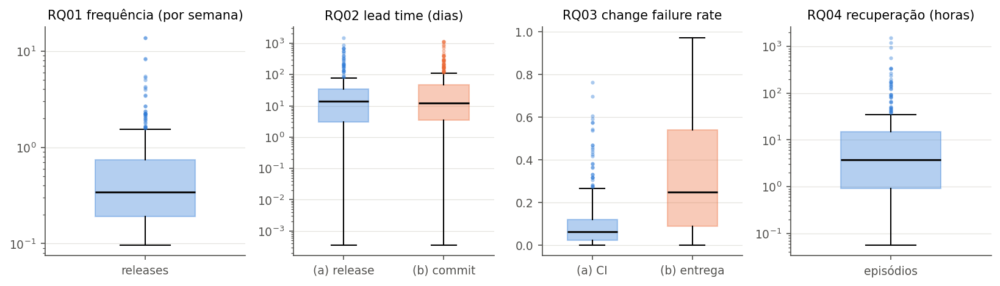
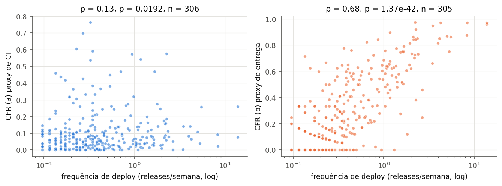

# Métricas DORA em repositórios populares do GitHub: quanto as conclusões dependem da definição operacional?

<!-- TODO(dupla): preencher nomes e e-mails. -->
**Integrante A, Integrante B**

Pontifícia Universidade Católica de Minas Gerais (PUC Minas)
Laboratório de Experimentação de Software
Belo Horizonte – MG – Brasil

---

## Abstract

We mined 306 popular GitHub repositories that use GitHub Actions and computed
approximations of the four DORA metrics over a 12-month window. The median
repository publishes one release every three weeks, has a lead time of about
two weeks and recovers from a CI failure in under four hours. A gold sample
of 300 releases labelled by two raters (κ = 0.85) showed that a
version/commit-based heuristic for corrective releases has precision 0.38;
a revised heuristic based on release notes reaches F1 0.59 on held-out
repositories. Swapping operational definitions changes the overall DORA
category of 21–38% of the repositories.

## Resumo

Mineramos 306 repositórios populares do GitHub que usam GitHub Actions e
calculamos aproximações das quatro métricas DORA em uma janela de 12 meses.
O repositório mediano publica uma release a cada três semanas, tem lead time
de cerca de duas semanas e se recupera de uma falha de CI em menos de quatro
horas. Uma amostra-ouro de 300 releases rotuladas por dois avaliadores
(κ = 0,85) mostrou que uma heurística de release corretiva baseada em
versão e commits tem precisão de 0,38; uma versão revista, baseada nas notas
de release, chega a F1 de 0,59 em repositórios separados para teste. Trocar
as definições operacionais muda a categoria DORA geral de 21% a 38% dos
repositórios.

## 1. Introdução

As métricas DORA — frequência de deploy, lead time, taxa de falha de
mudanças (CFR) e tempo de recuperação — são usadas para comparar o
desempenho de entrega de software. Em repositórios públicos, nenhuma delas é
observada diretamente: é preciso escolher *proxies*, como tratar uma
release publicada como deploy ou um run de CI vermelho como falha. Este
trabalho mede as métricas em 306 repositórios e avalia quanto as conclusões
dependem dessas escolhas. As hipóteses abaixo foram registradas antes da
análise.

- **RQ01 (frequência):** mediana na faixa Medium, com cauda longa.
- **RQ02 (lead time):** mediana entre uma semana e um mês; a variante por
  release maior que a por commit na maioria dos repositórios.
- **RQ03 (CFR):** o proxy de CI maior que o de releases corretivas.
- **RQ04 (recuperação):** mediana abaixo de 24 horas, com alguma censura.
- **RQ05 (frequência × CFR):** correlação fraca com o CFR de CI e
  positiva com o de releases, por efeito mecânico.
- **RQ06 (fatores):** diferenças entre linguagens, popularidade, idade e
  tipo de projeto.
- **RQ07 (sensibilidade):** ao menos uma troca de definição muda a
  categoria de parte dos repositórios.
- **RQ08 (rework rate):** maior que o CFR por releases e alto em termos
  absolutos, por causa da heurística.

## 2. Metodologia

**Fonte e janela.** Os dados vêm da API REST do GitHub, por um cliente
próprio com cache em disco, paginação e espera por cota. A janela vai de
1/10/2025 a 30/9/2026. A coleta foi feita em outubro de 2026.

**Seleção.** A busca por repositórios com pelo menos 1.000 estrelas, não
arquivados e com *push* na janela foi fatiada em oito faixas de estrelas,
porque cada consulta devolve no máximo 1.000 resultados. Os candidatos foram
embaralhados com semente 42 e avaliados até a amostra chegar a 306. Cada
candidato precisava ter GitHub Actions, pelo menos 5 releases publicadas (sem
draft nem pré-release) e 50 workflow runs válidos no *default branch* na
janela. A Tabela 1 resume o funil.

**Tabela 1.** Funil de seleção.

| Etapa | Restam | Saem | Motivo principal |
|---|--:|--:|---|
| Encontrados na busca | 37.401 | – | soma das oito faixas |
| Candidatos acessíveis | 7.451 | 29.950 | teto de 1.000 por consulta |
| Avaliados | 1.128 | 6.323 | amostra completada antes |
| Com GitHub Actions | 964 | 164 | sem workflows |
| ≥5 releases e ≥50 runs | **306** | 658 | 570 com menos de 5 releases |

**Definições.** Na combinação de referência (C1), deploy é uma release
principal; a frequência é o número delas por semana. O lead time (a) é a
mediana, entre as releases, da publicação menos o commit mais antigo do
`compare`; o (b) é a mediana sobre todos os commits. O CFR (a) é a
proporção de runs de CI com falha. O CFR (b) é a proporção de releases
seguidas por uma release corretiva em até sete dias, com censura dos últimos
sete dias da janela. O tempo de recuperação é a mediana, por workflow, entre
a primeira falha e o sucesso seguinte. O rework rate (RQ08) é a proporção de
releases corretivas. Para a RQ07, C2 usa releases e pré-releases, lead time
(b) e CFR (b); C3 usa tags datadas pelo commit apontado, lead time (b) e
CFR (a).

**Validação manual.** Foram sorteados 60 repositórios e 5 releases de
cada (semente 42). Dois avaliadores rotularam de forma independente, com
protocolo escrito: tipo do projeto, se as releases são entregas reais e se
cada release é corretiva (objetivo principal de corrigir defeito, julgado
pelas notas e commits, não pelo número da versão). A concordância (kappa de
Cohen) foi substancial para tipo (κ = 0,69), moderada para entregas
reais (κ = 0,41) e quase perfeita para corretividade
(κ = 0,85). As 43 divergências (13, 9 e 21) foram decididas
item a item com apoio de um assistente de IA, que aplicou os critérios do
protocolo às evidências; a justificativa de cada decisão está no
repositório. O consenso tem 107 releases corretivas (35,7%).

**Heurística corretiva.** A v1 marca uma release como corretiva se o
SemVer muda só o patch ou se algum commit contém *fix*, *hotfix*,
*revert* ou *bugfix*. Para revisá-la sem ajustar aos itens de
avaliação, os 60 repositórios foram divididos em metades de desenvolvimento e
teste; a regra foi escolhida na primeira e medida uma única vez na segunda.
A v2 marca a release quando as notas são dominadas por correções (seção de
correções sem seção de funcionalidades, ou mais itens de correção que de
funcionalidade) ou quando é um patch sem funcionalidade nas notas e com
commits de correção em número igual ou maior que os de funcionalidade
(Tabela 2). A v2 é usada no dataset final, mas não atinge a
meta de F1 ≥ 0,70.

**Tabela 2.** Heurística corretiva contra o consenso.

| Versão | Conjunto | *n* | Precisão | Recall | F1 |
|---|---|--:|--:|--:|--:|
| v1 | todos | 300 | 0,375 | 0,944 | 0,537 |
| v1 | teste | 150 | 0,290 | 0,950 | 0,444 |
| v2 | desenvolvimento | 150 | 0,624 | 0,791 | 0,697 |
| v2 | **teste** | **150** | **0,500** | **0,725** | **0,592** |

**Análise.** Mediana e IQR por métrica; Spearman na RQ05;
Kruskal-Wallis com correção de Holm sobre os 24 testes, ε² e
Cliff's δ (descritivo) na RQ06; percentual de mudança de categoria e
kappa ponderado linear na RQ07.

## 3. Resultados e discussão

**Tabela 3.** Métricas da amostra (mediana e quartis).

| Métrica | *n* | Mediana | Q1 | Q3 |
|---|--:|--:|--:|--:|
| Frequência (releases/semana) | 306 | 0,345 | 0,192 | 0,743 |
| Lead time (a) por release (dias) | 306 | 13,98 | 3,01 | 33,94 |
| Lead time (b) por commit (dias) | 306 | 12,24 | 3,44 | 47,52 |
| CFR (a) de CI | 306 | 0,065 | 0,023 | 0,122 |
| CFR (b) de releases | 305 | 0,250 | 0,091 | 0,540 |
| Recuperação (horas) | 284 | 3,75 | 0,93 | 14,95 |
| Rework rate | 306 | 0,542 | 0,344 | 0,729 |

**RQ01.** A mediana é de 0,345 release por semana, cerca de uma a cada
três semanas; só 1,3% dos repositórios chegam a Elite, 46,1% ficam em
Medium e 33,7% em Low (Figura 1). A hipótese se confirma: a
release do GitHub é um evento planejado, mais raro que o deploy contínuo.

**RQ02.** As medianas são 14,0 dias (a) e 12,2 dias (b), ambas em
Medium. A variante (a) é maior em 59,8% dos repositórios, o que confirma a
hipótese só em parte. A (a) explode com um único commit antigo
(*cherry-pick*); a (b) é dominada pelas releases grandes, que acumulam
muitos commits.

**RQ03.** O CFR (a) tem mediana de 6,5%, e 80,4% dos repositórios
ficam em Elite. O CFR (b) tem mediana de 25,0%, quase quatro vezes maior; a
hipótese não se confirma. Os proxies medem coisas diferentes: falha de
pipeline, que raramente chega ao usuário, e correção publicada. Com a v1, o
CFR (b) tinha mediana de 33,3%; como a v2 ainda tem cerca de um falso
positivo por verdadeiro positivo, o valor deve ser lido como limite superior
aproximado.

**RQ04.** A mediana é de 3,7 horas, e 84,9% dos repositórios se
recuperam em menos de um dia. Só 0,7% dos 15.709 episódios ficaram
censurados, mas eles aparecem em 22% dos repositórios.

*Figura 1. Distribuição das métricas DORA na amostra.*

**RQ05.** A correlação entre frequência e CFR (a) é fraca
(ρ = 0,13, *p* = 0,019), e com o CFR (b) é forte (ρ = 0,68,
*p* < 0,001; Figura 2). A segunda é em boa parte mecânica: mais
releases deixam mais releases a menos de sete dias de uma corretiva. Os dados
não sustentam nem refutam com segurança a afirmação do DORA de que velocidade
e estabilidade andam juntas.

*Figura 2. Frequência de deploy × CFR (a) e (b).*

**RQ06.** Após Holm, linguagem se associa a frequência
(ε² = 0,13), lead time (a) (0,17) e CFR (b) (0,16);
quartil de estrelas, só ao lead time (b) (0,06); e quartil de idade, a
frequência, aos dois lead times (0,22 e 0,23), ao CFR (b) (0,10) e
à recuperação (0,08). O quartil mais jovem publica mais (0,54 contra 0,29
release/semana) e tem CFR (b) mais alto (0,50 contra cerca de 0,20), o mesmo
mecanismo da RQ05. Para tipo do projeto (60 repositórios do consenso), nenhum
teste foi significativo; o menor *p* ajustado foi o da recuperação (0,059),
com bibliotecas mais lentas (10,5 horas) que aplicações e CLIs (3,2–3,5).
Com grupos pequenos, ausência de significância não indica equivalência.

**RQ07.** A Tabela 4 mostra a mudança da categoria geral. O
proxy de CFR é a escolha que mais pesa: trocar o CFR (a) pelo (b) muda a
categoria de CFR de 68,9% dos repositórios. A hipótese se confirma: C2
mudou mais que C3 na categoria geral. A causa, porém, foi o CFR, e não as
pré-releases. Na categoria de frequência, isoladamente, as tags de C3 mudaram
mais repositórios (19,0%) que as pré-releases de C2 (8,2%).

**Tabela 4.** Mudança da categoria DORA geral entre combinações.

| Par | *n* | Mudaram | % | κ ponderado |
|---|--:|--:|--:|--:|
| C1 × C2 | 283 | 108 | 38,2 | 0,415 |
| C1 × C3 | 284 | 60 | 21,1 | 0,714 |
| C2 × C3 | 283 | 100 | 35,3 | 0,500 |

**RQ08.** Com a v2, o rework rate tem mediana de 0,54, é maior que o
CFR (b) em 70,2% dos repositórios (Wilcoxon *p* < 0,001) e tem correlação
fraca e positiva com ele (ρ = 0,30). Com a v1, a mediana era 0,98 e a
correlação era negativa: a métrica media a presença de algum *fix*, não
o objetivo da release. A hipótese se confirma, e a amostra-ouro mostra que a
v1 não servia para essa métrica.

## 4. Ameaças à validade

**Construto.** Release não é deploy: a frequência medida é de releases,
e 570 dos descartes do funil foram por falta delas. A amostra-ouro não teve
nenhum repositório com releases rotuladas como entregas não reais (4
incertos). O CFR (a) mede falha de CI, não de produção. O CFR (b) e o rework
dependem de uma heurística com F1 de 0,59. A definição escolhida muda a
categoria de até 38% dos repositórios (RQ07).

**Interna.** Idade e volume de releases estão confundidos, e a
associação entre frequência e CFR (b) é em parte mecânica. Os fatores da RQ06
foram testados isoladamente. A v2 depende do estilo das notas de release, que
varia entre comunidades. Episódios censurados e meses no teto de 1.000 runs
(35 repositórios) podem enviesar a recuperação e o CFR (a). As 43
divergências foram decididas com apoio de IA, e não em reunião dos
avaliadores. Elas afetam 10% dos rótulos, e as justificativas estão
registradas.

**Externa.** A amostra tem projetos abertos, populares, com Actions e
releases. A busca alcançou só os mais populares de cada faixa (7.451 de 37.401
candidatos). Os resultados descrevem uma janela de 12 meses.

**Conclusão.** Os 24 testes da RQ06 foram corrigidos por Holm. Várias
linguagens e o tipo *outro* têm menos de cinco repositórios. A metade de
teste da heurística tem 40 releases corretivas, e o F1 estimado tem
incerteza considerável.

## 5. Replicação cruzada

<!-- TODO(dupla): substituir pelo relato real após receber o grupo sorteado. -->
A replicação do pipeline de outro grupo ainda não foi feita. Falta
identificar o grupo e obter o repositório, o CSV original e a lista de 30
repositórios. O procedimento (execução só pelo README, comparação com
`replicacao.comparar`, Issues no repositório autor) está documentado
em [`artigo/replicacao_cruzada.md`](replicacao_cruzada.md). Até 23/10/2026, nenhuma Issue de
grupo replicador havia sido aberta no nosso repositório.

## 6. Conclusão

As métricas DORA podem ser aproximadas com dados públicos do GitHub, mas os
valores e as categorias dependem da definição operacional. O proxy de CFR é a
escolha que mais pesa. A validação manual mostrou que uma heurística ingênua
de release corretiva tem precisão de 0,38. Uma versão baseada nas notas de
release melhora o resultado sem chegar à meta. Comparações de desempenho DORA
entre projetos abertos devem declarar a definição usada e a validação dos
*proxies*.

## Disponibilidade

Repositório:
<https://github.com/gabrieltinoco/Laboratorio-Experimentacao-de-Software>
(pasta `Laboratorio03`).

<!-- TODO(dupla): link do GitHub Projects. -->
GitHub Projects: `<preencher>`.

## Referências

- Cohen, J. (1960). A coefficient of agreement for nominal scales.
  *Educational and Psychological Measurement*, 20(1):37–46.
- DORA (2024). *A history of DORA's software delivery metrics*.
  <https://dora.dev/insights/dora-metrics-history/>.
- Landis, J. R. and Koch, G. G. (1977). The measurement of observer agreement
  for categorical data. *Biometrics*, 33(1):159–174.
- Wohlin, C. et al. (2012). *Experimentation in Software Engineering*.
  Springer.
